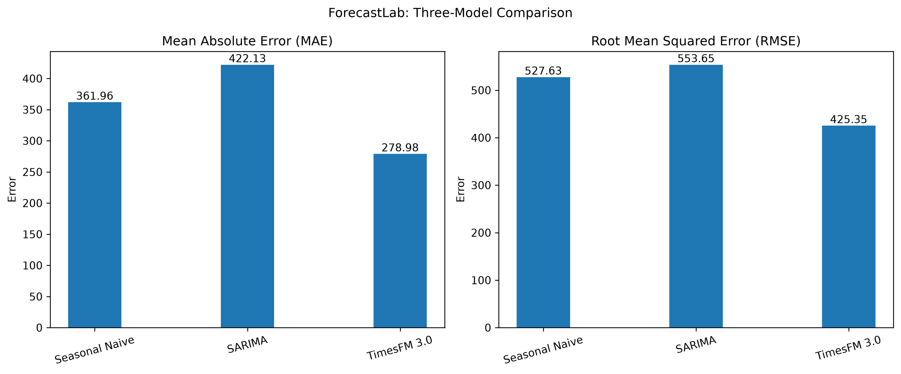
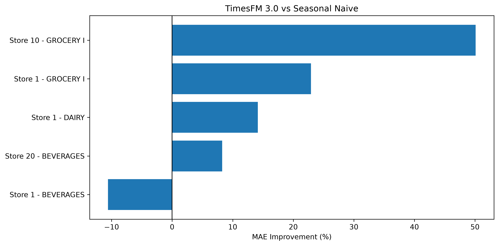

# ForecastLab — Benchmarking TimesFM for Retail Demand Forecasting

## Overview

ForecastLab evaluates Google's pretrained TimesFM 3.0 time-series foundation model for retail sales forecasting. It compares zero-shot forecasting with a seasonal-naive baseline and a traditional SARIMA statistical model using the Kaggle Store Sales – Time Series Forecasting dataset.

The goal is to assess whether a pretrained time-series foundation model can improve forecasting accuracy without fine-tuning on the retail dataset.

## Tech Stack

- Python
- Pandas and NumPy
- Matplotlib
- Scikit-learn
- Statsmodels
- TimesFM 3.0
- Jupyter Notebook

## Methodology

1. Load and explore historical retail sales data.
2. Select store–product-family time series.
3. Reserve the final 28 observations for validation.
4. Generate a seasonal-naive forecast by repeating the last seven days four times.
5. Generate a 28-day zero-shot forecast using pretrained TimesFM 3.0.
6. Fit a SARIMA model using the configuration `SARIMA(1,1,1)(1,1,1,7)`.
7. Compare forecasts using Mean Absolute Error (MAE) and Root Mean Squared Error (RMSE).

Lower MAE and RMSE indicate better forecasting accuracy.

## Initial Benchmark: Store 1 — GROCERY I

| Model | MAE | RMSE |
|---|---:|---:|
| Seasonal Naive | 361.96 | 527.63 |
| TimesFM 3.0 | 278.98 | 425.35 |
| **Improvement** | **22.93%** | **19.38%** |

TimesFM improved both evaluation metrics compared with the seasonal-naive baseline for this series.

## Multi-Series Benchmark

Five store–product-family combinations were evaluated using the same 28-observation validation horizon.

| Store | Product Family | MAE Improvement | RMSE Improvement |
|---:|---|---:|---:|
| 1 | GROCERY I | 22.93% | 19.38% |
| 1 | BEVERAGES | -10.59% | -2.26% |
| 1 | DAIRY | 14.14% | 7.56% |
| 10 | GROCERY I | 50.09% | 50.26% |
| 20 | BEVERAGES | 8.27% | 1.58% |
| **Average** | | **16.97%** | **15.31%** |

### Key Findings

- TimesFM achieved lower MAE and RMSE on four of the five evaluated series.
- The strongest improvement occurred for Store 10 — GROCERY I, with approximately 50% improvement on both metrics.
- TimesFM underperformed on Store 1 — BEVERAGES, highlighting that performance varies by series.
- The average per-series percentage improvement was 16.97% for MAE and 15.31% for RMSE.

These are preliminary findings from five series and one validation period, not evidence of generalization across all retail sales.

## Three-Model Benchmark

We compared three forecasting approaches on Store 1 — GROCERY I using a 28-day validation horizon.

| Model | MAE | RMSE |
|---|---:|---:|
| Seasonal Naive | 361.96 | 527.63 |
| SARIMA(1,1,1)(1,1,1,7) | 422.13 | 553.65 |
| **TimesFM 3.0** | **278.98** | **425.35** |

### Model Performance Visualization



### Findings

- TimesFM 3.0 achieved the lowest forecast errors among the three evaluated approaches.
- Seasonal Naive outperformed the tested SARIMA configuration, showing the value of evaluating simple baselines.
- SARIMA was tested with one parameter configuration without systematic hyperparameter tuning.
- TimesFM was applied in zero-shot mode, without fine-tuning on the retail dataset.

### Conclusion

In this initial experiment, TimesFM 3.0 produced the most accurate forecasts among the three evaluated approaches. Results are limited to one store–product-family series and one 28-day validation period; broader testing is needed before drawing general conclusions.

## Benchmark Visualization

### TimesFM Improvement Across Five Series



### Comparison of All Three Models


## Project Structure

```text
forecastlab/
├── data/
│   ├── raw/
│   └── processed/
├── notebooks/
│   └── 01_data_exploration.ipynb
├── results/
│   └── timesfm_mae_improvement.png
├── src/
├── .venv/
└── README.md
```

## Limitations

- The multi-series evaluation covers five store–product-family combinations.
- The three-model comparison covers one series and one 28-day validation period.
- SARIMA was evaluated with one configuration and was not systematically tuned.
- The seasonal-naive baseline is simple and may not represent the strongest available forecasting method.
- Broader testing is needed to assess robustness across stores, product families, and time periods.

## Future Improvements

- Expand evaluation to more store–product-family combinations.
- Visualize actual sales against all three forecasts.
- Evaluate additional validation periods.
- Save benchmark results for reproducibility.
- Tune SARIMA parameters and compare against additional forecasting baselines.

## Dataset

[Kaggle — Store Sales: Time Series Forecasting](https://www.kaggle.com/competitions/store-sales-time-series-forecasting)

## Model

[Google Research — TimesFM](https://github.com/google-research/timesfm)

## Status

Initial TimesFM zero-shot benchmark, five-series evaluation, and three-model comparison completed. Broader evaluation, forecast visualization, and statistical-model tuning remain as future work.